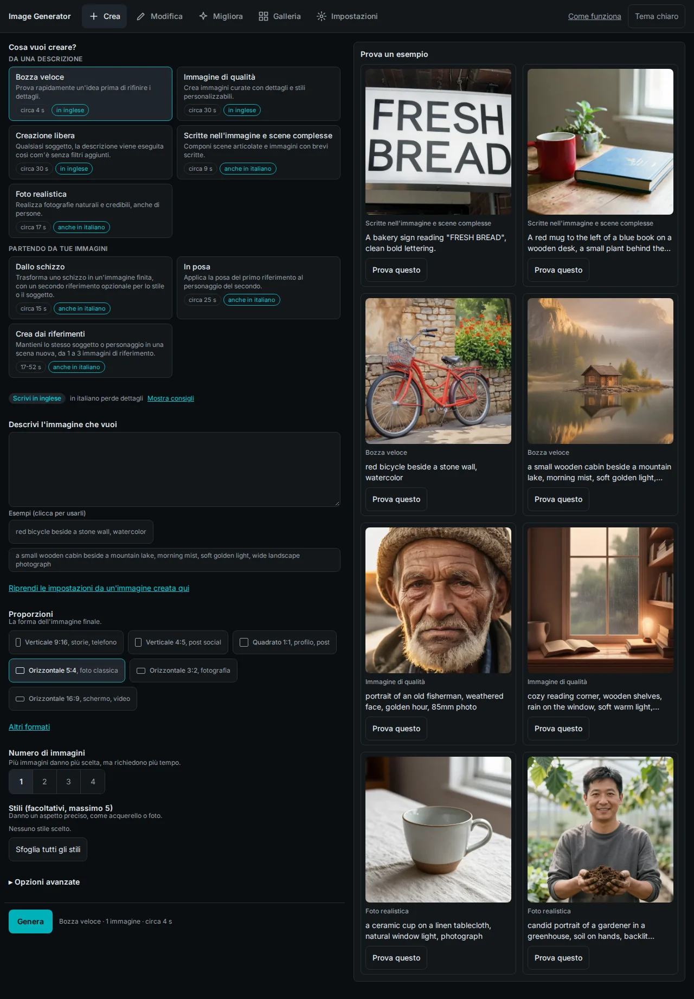
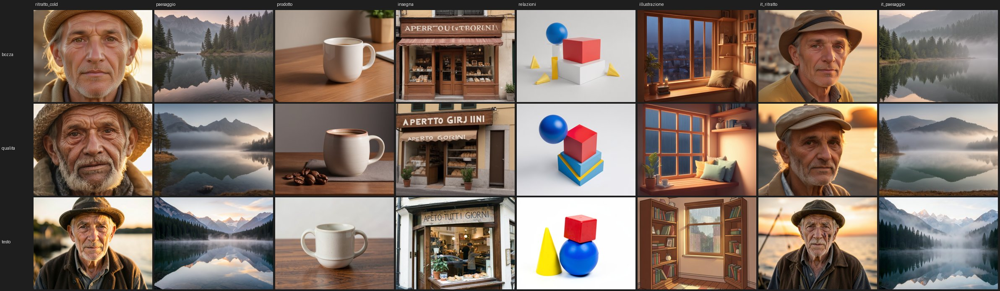
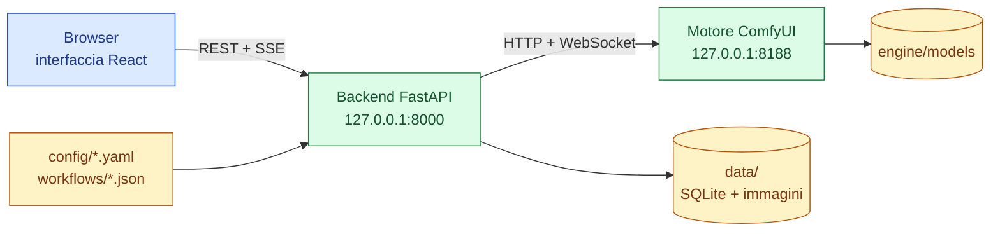

[English](./README.md) | **Italiano**

# Image Generator

Un'applicazione web locale, in italiano, per creare e modificare immagini con modelli di intelligenza artificiale sulla propria scheda video NVIDIA.

[](https://github.com/AndreaBonn/image-generator/actions/workflows/ci.yml)
[](https://github.com/AndreaBonn/image-generator/actions/workflows/ci.yml)
[](https://github.com/AndreaBonn/image-generator/actions/workflows/ci.yml)
[](https://github.com/AndreaBonn/image-generator/actions/workflows/ci.yml)
[](./LICENSE)
[](./backend/pyproject.toml)

Invece di scegliere un modello e regolare decine di parametri, si sceglie il lavoro da fare: una bozza veloce, un'immagine curata, una scritta, la modifica di una parte di una foto. L'app carica il modello adatto a quel lavoro e indica in che lingua scrivere la descrizione.

Sotto c'è un backend FastAPI con un'interfaccia React che pilotano un motore [ComfyUI](https://github.com/Comfy-Org/ComfyUI) senza interfaccia propria. Ogni lavoro corrisponde a un workflow ComfyUI fissato nel repository e a modelli scaricati con sha256 verificato. Una volta installata funziona senza internet, e le immagini restano sul computer.

Per una guida passo passo di ogni pagina, vedi la **[guida utente](./docs/user-guide.it.md)**.

## In pratica



Risultati a confronto dal benchmark della fase 0 (righe: `bozza`, `qualita`, `testo`; stesse descrizioni e stesso seed):



## Funzionalità

L'app ha cinque pagine: **Crea**, **Modifica**, **Migliora**, **Galleria** e **Impostazioni**, più una guida interna (**Come funziona**). I lavori sono definiti in `config/tasks.yaml`.

| Pagina | Lavoro | Cosa fa | Modello | Lingua della descrizione | Tempo* |
|---|---|---|---|---|---|
| Crea | Bozza veloce | Bozza rapida per provare un'idea | Juggernaut XL v8 + SDXL-Lightning | inglese | ~4 s |
| Crea | Immagine di qualità | Immagine curata, con gli stili | Juggernaut XL v8 | inglese | ~30 s |
| Crea | Creazione libera | Qualsiasi soggetto, descrizione eseguita così com'è, senza filtri aggiunti | Lustify SDXL | inglese | ~30 s |
| Crea | Scritte nell'immagine e scene complesse | Scritte e scene con più oggetti | FLUX.2 [klein] 4B | italiano o inglese | ~9 s |
| Crea | Foto realistica | Foto naturali, anche di persone | Z-Image Turbo | italiano o inglese | ~17 s |
| Crea | Dallo schizzo | Schizzo disegnato nell'app o caricato, più un riferimento di stile facoltativo | FLUX.2 [klein] 4B | italiano o inglese | ~15 s |
| Crea | In posa | Applica la posa di una figura al personaggio di un'altra | FLUX.2 [klein] 4B | italiano o inglese | ~25 s |
| Crea | Crea dai riferimenti | Stesso soggetto in una scena nuova, da 1 a 3 foto di riferimento | FLUX.2 [klein] 4B | italiano o inglese | 17-52 s |
| Modifica | Modifica con le parole | Si descrive la modifica a parole | FLUX.2 [klein] 4B | italiano o inglese | non misurato |
| Modifica | Modifica una parte | Rigenera la zona colorata con il pennello | Juggernaut XL + inpaint di Fooocus | inglese | ~30 s |
| Modifica | Allarga l'immagine | Estende l'immagine del 30% sui lati scelti | Juggernaut XL + inpaint di Fooocus | inglese (facoltativa) | ~30 s |
| Migliora | Variazione leggera / forte | Variazione lieve o marcata di un'immagine | Juggernaut XL v8 | inglese (facoltativa) | 15-30 s |
| Migliora | Ingrandisci | Ingrandimento ×2 o ×4, fino a 8192 px per lato | 4x-UltraSharp | nessuna | pochi secondi |
| Migliora | Ingrandisci con rifinitura | Ingrandimento ×2 con dettagli rifatti, intensità regolabile | 4x-UltraSharp + Juggernaut XL | inglese (facoltativa) | 1-2 min |
| Migliora | Rimuovi lo sfondo | Tiene solo il soggetto, in un PNG trasparente | BiRefNet | nessuna | non misurato |

\* Misurati su una RTX 4060 Laptop con 8 GB. Il primo lavoro dopo l'avvio, o dopo un cambio di famiglia di modelli, richiede qualche secondo in più. Dettagli in [docs/benchmark.md](./docs/benchmark.md).

Attorno ai lavori:

- **Stili con anteprima**: i lavori SDXL offrono 277 stili, ciascuno con la miniatura dello stesso soggetto. Fino a 5 per immagine. Le miniature si generano in locale, una volta sola, dalla pagina Impostazioni.
- **Controllo della lingua**: i modelli SDXL sono addestrati in inglese. Se la descrizione sembra italiana, l'app avvisa e propone un lavoro che capisce l'italiano.
- **Risultati riproducibili**: ogni immagine ha un "codice del risultato" (seed) che si può tenere; stessa descrizione e stesso codice danno la stessa immagine, pixel per pixel.
- **Ricetta dentro il PNG**: ogni PNG salvato contiene le proprie impostazioni. Trascinandolo di nuovo sulla pagina Crea si ripristinano lavoro, descrizione, codice, proporzioni, stili e opzioni avanzate.
- **Galleria**: ricerca nel testo, filtri (create, modificate, migliorate, preferite), dettaglio con l'immagine di origine, azioni "continua da qui" e un cestino che si svuota solo a mano.
- **Impostazioni**: stato del motore, memoria della scheda video e disco, modello in memoria, avviso se un altro programma usa la GPU, download dei modelli con un clic e controllo dello spazio, generazione di esempi e anteprime, tema chiaro e scuro.
- **Modelli mancanti**: scegliendo un lavoro i cui modelli non sono installati, l'app propone di scaricarli subito.

## Stack tecnologico

- **Frontend**: React 19, React Router 7, TanStack Query 5, Tailwind CSS 4, Vite 8, TypeScript 5
- **Backend**: FastAPI, Pydantic 2 e pydantic-settings, SQLAlchemy 2 con SQLite, Alembic, Pillow, SSE (sse-starlette), httpx e websockets per parlare col motore
- **Motore**: ComfyUI `v0.38.2`, PyTorch con wheel per CUDA 13, in un ambiente virtuale proprio sotto `engine/`
- **Strumenti**: uv, ruff, mypy (strict), pytest, Vitest, Playwright, ESLint

## Architettura



Il backend serve l'interfaccia compilata, trasforma ogni lavoro in un grafo ComfyUI (i parametri si legano per titolo del nodo, mai per id numerico), lo mette in coda nel motore e manda al browser avanzamento e anteprime dal vivo via SSE. Entrambi i processi ascoltano solo su `127.0.0.1`.

## Prerequisiti

- Linux con scheda video NVIDIA da almeno 8 GB di VRAM e driver che supporta CUDA 13
- [uv](https://docs.astral.sh/uv/)
- Node.js 22.12 o successivo (per compilare l'interfaccia basta il 20.19; i test richiedono il 22.12)
- Git
- Spazio libero su disco: circa 7,5 GB per il motore più circa 29 GB di modelli per il profilo completo, oppure circa 8,3 GB di modelli con `--profile base`. L'installazione tiene almeno 5 GB liberi e altrimenti rifiuta di scaricare.

Non serve un'installazione di Fooocus. Windows e macOS non sono provati: vedi [Windows e macOS](#windows-e-macos).

## Installazione

1. Clona il repository:

   ```bash
   git clone https://github.com/AndreaBonn/image-generator.git
   cd image-generator
   ```

2. Guarda cosa verrebbe installato, senza scaricare nulla:

   ```bash
   uv run --script scripts/install.py --dry-run
   ```

3. Installa motore, dipendenze di backend e frontend, stili e tutti i modelli:

   ```bash
   uv run --script scripts/install.py
   ```

   Per i soli modelli SDXL e l'upscaler aggiungi `--profile base`. L'installazione salta i passi già fatti, quindi si può rilanciare dopo un'interruzione. Un singolo passo si riesegue con `--only engine|backend_deps|frontend_build|styles|models`.

4. Controlla quali modelli sono presenti e quanto spazio occupano:

   ```bash
   uv run --script scripts/install_models.py --list
   ```

### Riusare un'installazione di Fooocus

Se Fooocus è già sul disco, i modelli che condivide con questa app si possono spostare o copiare invece di scaricarli. Lancia prima senza `--apply` per vedere cosa farebbe:

```bash
uv run --script scripts/migrate_from_fooocus.py --fooocus-dir ~/Fooocus --apply
```

Sulla stessa partizione i file vengono spostati all'istante; altrimenti vengono copiati e verificati, e gli originali restano.

## Configurazione

I valori predefiniti funzionano senza `.env`. Per cambiarli, copia `.env.example` in `.env`. I percorsi relativi partono dalla radice del repository.

| Nome | Obbligatoria | Descrizione |
|---|---|---|
| `COMFY_URL` | ⚠️ | Indirizzo del motore. Deve puntare a `127.0.0.1`. Predefinito `http://127.0.0.1:8188` |
| `ENGINE_MODE` | ⚠️ | `comfy` per il motore vero, `fake` per far girare il backend senza GPU (immagini segnaposto) |
| `PREVIEW_METHOD` | ⚠️ | Metodo di anteprima dal vivo passato al motore. Predefinito `latent2rgb` |
| `MODELS_DIR` | ⚠️ | Cartella dei modelli. Predefinita `engine/models` |
| `COMFY_OUTPUT_DIR` | ⚠️ | Cartella di output del motore. Predefinita `engine/ComfyUI/output` |
| `DATA_DIR` | ⚠️ | Database, immagini, miniature, file caricati. Predefinita `data` |
| `WORKFLOWS_DIR` | ⚠️ | Grafi ComfyUI. Predefinita `workflows` |
| `CONFIG_DIR` | ⚠️ | Cataloghi di modelli, lavori e stili. Predefinita `config` |
| `MIN_FREE_DISK_GB` | ⚠️ | Spazio minimo che i download lasciano libero. Predefinito `5` |
| `JOB_TIMEOUT_S` | ⚠️ | Durata massima di un lavoro, in secondi. Predefinita `600` |
| `HOST` | ⚠️ | È accettato solo `127.0.0.1` |
| `PORT` | ⚠️ | Porta del backend. Predefinita `8000` |
| `STYLES_DIR` | ⚠️ | File degli stili SDXL. Predefinita `DATA_DIR/styles` |

## Esecuzione locale

Dal menu delle applicazioni (Linux), una volta sola:

```bash
./scripts/install_launcher.sh
```

Compaiono due voci: **Image Generator** avvia motore e app in una finestra dedicata, **Chiudi Image Generator** li ferma e libera la memoria della scheda video. Per toglierle: `./scripts/install_launcher.sh --uninstall`.

Dal terminale:

```bash
./scripts/start.sh   # motore + backend + interfaccia compilata
./scripts/stop.sh    # ferma solo i processi avviati da start.sh
```

Quando compare `Pronto: apri http://127.0.0.1:8000`, apri quell'indirizzo. Ctrl+C ferma tutto.

Per sviluppare il frontend con il ricaricamento automatico, lancia `npm run dev` in `frontend/` con il backend acceso.

### Windows e macOS

Gli script di installazione, avvio e arresto sono in Python e scelgono percorsi e comandi in base al sistema operativo: su Windows si usano `scripts\install.cmd`, `scripts\start.cmd` e `scripts\stop.cmd`. Sono stati provati solo su Linux. Limiti noti: Windows richiede una scheda NVIDIA, e il lanciatore nel menu delle applicazioni esiste solo per Linux; macOS non ha CUDA, quindi FLUX.2 [klein] fp8 e i nodi di inpaint potrebbero non funzionare e i tempi saranno diversi.

## Struttura del repository

```text
.
├── backend/      app FastAPI (progetto uv): api, services, repositories, client del motore, migrazioni
├── frontend/     app React + Vite (npm): pagine, componenti, hook, test unitari ed e2e
├── config/       models.yaml, tasks.yaml, styles.yaml, template dei percorsi di ComfyUI
├── workflows/    grafi ComfyUI in formato API, uno per tipo di lavoro
├── engine/       installatore di ComfyUI; ComfyUI/ e models/ nascono qui (esclusi da git)
├── scripts/      installatore, avvio/arresto, gestione modelli, benchmark, migrazione da Fooocus
├── docs/         guida utente, benchmark, screenshot
└── SPEC.md       specifica di riferimento
```

## Moduli principali

- `backend/app/engine/`: client ComfyUI, costruttore dei workflow (lega i valori ai nodi con titolo `@...`), motore finto per i test
- `backend/app/services/`: coda dei lavori, salvataggio delle generazioni, upload e ricette, download dei modelli, generazione di esempi e anteprime
- `backend/app/api/v1/`: endpoint REST sotto `/api/v1` (jobs, generations, uploads, models, styles, tasks, system, maintenance, assets) con stream SSE per l'avanzamento di lavori e download
- `scripts/install.py`: installatore a comando unico, composto da `install_plan.py` (pianificazione pura), `install_detect.py` (stato del filesystem) e `install_runner.py` (esecuzione)

Un lavoro nuovo richiede la sua voce in `config/tasks.yaml`, il grafo in `workflows/` e i modelli registrati in `config/models.yaml` con sorgente e sha256.

## Testing

```bash
cd backend && uv run pytest                 # backend, motore finto, senza GPU
cd backend && uv run pytest -m engine       # test di contratto, serve ComfyUI su :8188
cd frontend && npm test                     # test unitari Vitest
cd frontend && npm run test:e2e             # end-to-end Playwright
uv run --no-project --with pytest --with pyyaml --with huggingface_hub pytest scripts/tests
```

I test del backend sono in `backend/tests`, quelli unitari del frontend in `frontend/tests`, gli end-to-end in `frontend/e2e`.

## CI

`.github/workflows/ci.yml` gira a ogni push e pull request: test del backend con ruff, mypy e coverage, lint, typecheck e test del frontend con coverage, test degli script di installazione. Non girano in CI i test di contratto con la GPU, gli end-to-end e i test dell'installatore marcati `local_install` (controllano una macchina dove l'app è già installata). Sui push a `main` pubblica i badge di test e coverage sul branch `badges`, così su `main` non arrivano commit del bot.

## Licenze dei modelli

La licenza del codice non copre i modelli. FLUX.2 [klein] 4B, Z-Image Turbo e il text encoder Qwen3 sono Apache 2.0; BiRefNet è MIT; SDXL-Lightning e la LoRA offset sono OpenRAIL++. 4x-UltraSharp è CC BY-NC-SA 4.0, quindi non utilizzabile a scopo commerciale. Le licenze di Juggernaut XL, Lustify SDXL e della patch di inpaint di Fooocus vanno verificate prima di qualsiasi uso commerciale delle immagini. La pagina Impostazioni mostra la licenza di ogni modello.

## Sicurezza

L'app non ha autenticazione ed è pensata per un solo utente su un solo computer: entrambi i processi ascoltano su `127.0.0.1`. Per segnalare una vulnerabilità, consulta [SECURITY.it.md](./SECURITY.it.md).

## Licenza

Distribuito con licenza GNU General Public License v3.0. Vedi [LICENSE](./LICENSE).

## Supporta il progetto

Una stella su [GitHub](https://github.com/AndreaBonn/image-generator) aiuta altri a trovare il progetto.
