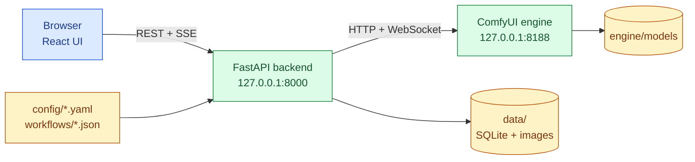

**English** | [Italiano](./README.it.md)

# Image Generator

A local web app, in Italian, for creating and editing images with AI models on your own NVIDIA GPU.

[](https://github.com/AndreaBonn/image-generator/actions/workflows/ci.yml)
[](https://github.com/AndreaBonn/image-generator/actions/workflows/ci.yml)
[](https://github.com/AndreaBonn/image-generator/actions/workflows/ci.yml)
[](https://github.com/AndreaBonn/image-generator/actions/workflows/ci.yml)
[](./LICENSE)
[](./backend/pyproject.toml)

Instead of picking a model and tuning dozens of parameters, you pick the job to do: a quick draft, a polished image, lettering, editing one part of a photo. The app loads the right model for that job and tells you which language to write the description in.

Under the hood it is a FastAPI backend and a React interface that drive a headless [ComfyUI](https://github.com/Comfy-Org/ComfyUI) engine. Every job maps to a pinned ComfyUI workflow and to models downloaded with a verified sha256. Once installed it works offline, and images never leave the computer.

The interface is in Italian. For a step-by-step walkthrough of every page, see the **[user guide](./docs/user-guide.md)**.

## In practice


Side-by-side output from the phase 0 benchmark (rows: `bozza`, `qualita`, `testo`; same prompts and seed):


## Features

The app has five pages: **Crea** (create), **Modifica** (edit), **Migliora** (improve), **Galleria** (gallery) and **Impostazioni** (settings), plus an in-app guide (**Come funziona**). The jobs come from `config/tasks.yaml`.

| Page | Job (UI label) | What it does | Model | Prompt language | Time* |
|---|---|---|---|---|---|
| Crea | Bozza veloce | Quick draft to try an idea | Juggernaut XL v8 + SDXL-Lightning | English | ~4 s |
| Crea | Immagine di qualità | Polished image, supports styles | Juggernaut XL v8 | English | ~30 s |
| Crea | Creazione libera | Any subject, prompt run as written, no added filters | Lustify SDXL | English | ~30 s |
| Crea | Scritte nell'immagine e scene complesse | Lettering and multi-object scenes | FLUX.2 [klein] 4B | Italian or English | ~9 s |
| Crea | Foto realistica | Natural photos, people included | Z-Image Turbo | Italian or English | ~17 s |
| Crea | Dallo schizzo | Sketch drawn in the app or uploaded, plus an optional style reference | FLUX.2 [klein] 4B | Italian or English | ~15 s |
| Crea | In posa | Applies the pose of one picture to the character of another | FLUX.2 [klein] 4B | Italian or English | ~25 s |
| Crea | Crea dai riferimenti | Same subject in a new scene, from 1 to 3 reference photos | FLUX.2 [klein] 4B | Italian or English | 17-52 s |
| Modifica | Modifica con le parole | Describe the change in plain words | FLUX.2 [klein] 4B | Italian or English | not measured |
| Modifica | Modifica una parte | Regenerates the area painted with the brush | Juggernaut XL + Fooocus inpaint | English | ~30 s |
| Modifica | Allarga l'immagine | Extends the image by 30% on the chosen sides | Juggernaut XL + Fooocus inpaint | English (optional) | ~30 s |
| Migliora | Variazione leggera / forte | Subtle or strong variation of an image | Juggernaut XL v8 | English (optional) | 15-30 s |
| Migliora | Ingrandisci | Upscale ×2 or ×4, up to 8192 px per side | 4x-UltraSharp | none | a few seconds |
| Migliora | Ingrandisci con rifinitura | ×2 upscale with re-detailing, adjustable strength | 4x-UltraSharp + Juggernaut XL | English (optional) | 1-2 min |
| Migliora | Rimuovi lo sfondo | Keeps the subject on a transparent PNG | BiRefNet | none | not measured |

\* Measured on an RTX 4060 Laptop with 8 GB. The first job after startup, or after switching model family, takes a few seconds more. Details in [docs/benchmark.md](./docs/benchmark.md).

Around the jobs:

- **Styles with previews**: SDXL jobs offer 277 style presets with a thumbnail of the same subject in each style. Up to 5 per image. Thumbnails are generated locally, once, from the settings page.
- **Prompt language check**: SDXL models were trained on English. When the description looks Italian, the app warns and offers a job that understands Italian.
- **Reproducible results**: every image has a seed ("codice del risultato") that can be kept; same prompt and seed give pixel-identical output.
- **Recipes inside the PNG**: each saved PNG embeds its settings. Dropping it back on the Crea page restores job, prompt, seed, aspect ratio, styles and advanced options.
- **Gallery**: text search, filters (created, edited, improved, favourites), detail view with the source image, "continue from here" actions, and a trash bin that is emptied only by hand.
- **Settings**: engine status, VRAM and disk usage, loaded model, a warning when another program is using the GPU, one-click model downloads with disk-space check, example and preview generation, light and dark theme.
- **Missing models**: picking a job whose models are not installed offers to download them on the spot.

## Tech stack

- **Frontend**: React 19, React Router 7, TanStack Query 5, Tailwind CSS 4, Vite 8, TypeScript 5
- **Backend**: FastAPI, Pydantic 2 and pydantic-settings, SQLAlchemy 2 with SQLite, Alembic, Pillow, SSE (sse-starlette), httpx and websockets to talk to the engine
- **Engine**: ComfyUI `v0.38.2`, PyTorch with CUDA 13 wheels, in its own virtual environment under `engine/`
- **Tooling**: uv, ruff, mypy (strict), pytest, Vitest, Playwright, ESLint

## Architecture



The backend serves the built interface, turns each job into a ComfyUI graph (parameters are bound by node title, never by numeric id), queues it on the engine and streams progress and live previews to the browser over SSE. Both processes listen on `127.0.0.1` only.

## Prerequisites

- Linux with an NVIDIA GPU with at least 8 GB of VRAM and a driver that supports CUDA 13
- [uv](https://docs.astral.sh/uv/)
- Node.js 22.12 or later (20.19 is enough to build the interface; the test runner needs 22.12)
- Git
- Free disk space: about 7.5 GB for the engine plus about 29 GB of models for the full profile, or about 8.3 GB of models for `--profile base`. The installer keeps at least 5 GB free and refuses to download otherwise.

A Fooocus install is not required. Windows and macOS are not tested: see [Windows and macOS](#windows-and-macos).

## Installation

1. Clone the repository:

   ```bash
   git clone https://github.com/AndreaBonn/image-generator.git
   cd image-generator
   ```

2. Preview what will be installed, without downloading anything:

   ```bash
   uv run --script scripts/install.py --dry-run
   ```

3. Install engine, backend and frontend dependencies, styles and all models:

   ```bash
   uv run --script scripts/install.py
   ```

   For the SDXL models and the upscaler only, add `--profile base`. The installer skips steps that are already done, so it can be re-run after an interruption. A single step can be re-run with `--only engine|backend_deps|frontend_build|styles|models`.

4. Check which models are present and how much space they take:

   ```bash
   uv run --script scripts/install_models.py --list
   ```

### Reusing an existing Fooocus install

If Fooocus is already on disk, the models it shares with this app can be moved or copied instead of downloaded. Run without `--apply` first to see the plan:

```bash
uv run --script scripts/migrate_from_fooocus.py --fooocus-dir ~/Fooocus --apply
```

On the same partition the files are moved instantly; otherwise they are copied and verified, and the originals stay.

## Configuration

Defaults work without a `.env`. To change them, copy `.env.example` to `.env`. Relative paths are resolved from the repository root.

| Name | Required | Description |
|---|---|---|
| `COMFY_URL` | ⚠️ | Engine URL. Must point to `127.0.0.1`. Default `http://127.0.0.1:8188` |
| `ENGINE_MODE` | ⚠️ | `comfy` for the real engine, `fake` to run the backend without a GPU (placeholder images) |
| `PREVIEW_METHOD` | ⚠️ | Live preview method passed to the engine. Default `latent2rgb` |
| `MODELS_DIR` | ⚠️ | Model folder. Default `engine/models` |
| `COMFY_OUTPUT_DIR` | ⚠️ | Engine output folder. Default `engine/ComfyUI/output` |
| `DATA_DIR` | ⚠️ | Database, images, thumbnails, uploads. Default `data` |
| `WORKFLOWS_DIR` | ⚠️ | ComfyUI graphs. Default `workflows` |
| `CONFIG_DIR` | ⚠️ | Model, task and style catalogs. Default `config` |
| `MIN_FREE_DISK_GB` | ⚠️ | Minimum free space kept by downloads. Default `5` |
| `JOB_TIMEOUT_S` | ⚠️ | Maximum duration of one job, in seconds. Default `600` |
| `HOST` | ⚠️ | Only `127.0.0.1` is accepted |
| `PORT` | ⚠️ | Backend port. Default `8000` |
| `STYLES_DIR` | ⚠️ | SDXL style files. Default `DATA_DIR/styles` |

## Running locally

From the applications menu (Linux), run once:

```bash
./scripts/install_launcher.sh
```

Two entries appear: **Image Generator** starts engine and app in a dedicated window, **Chiudi Image Generator** stops both and frees the GPU memory. Remove them with `./scripts/install_launcher.sh --uninstall`.

From a terminal:

```bash
./scripts/start.sh   # engine + backend + built interface
./scripts/stop.sh    # stops only the processes start.sh launched
```

When `Pronto: apri http://127.0.0.1:8000` appears, open that address. Ctrl+C stops everything.

For frontend development with hot reload, run `npm run dev` in `frontend/` while the backend is up.

### Windows and macOS

The install, start and stop scripts are Python and pick paths and commands per OS: on Windows use `scripts\install.cmd`, `scripts\start.cmd` and `scripts\stop.cmd`. They have been run only on Linux. Known limits: Windows needs an NVIDIA GPU, and the applications-menu launcher is Linux-only; macOS has no CUDA, so FLUX.2 [klein] fp8 and the inpaint nodes may not work and timings will differ.

## Repository structure

```text
.
├── backend/      FastAPI app (uv project): api, services, repositories, engine client, migrations
├── frontend/     React + Vite app (npm): pages, components, hooks, unit and e2e tests
├── config/       models.yaml, tasks.yaml, styles.yaml, ComfyUI path template
├── workflows/    ComfyUI graphs in API format, one per job type
├── engine/       ComfyUI installer; ComfyUI/ and models/ are created here (gitignored)
├── scripts/      installer, start/stop, model manager, benchmark, Fooocus migration
├── docs/         user guide, benchmark, screenshots
└── SPEC.md       authoritative specification
```

## Main modules

- `backend/app/engine/`: ComfyUI client, workflow builder (binds values to nodes titled `@...`), fake engine for tests
- `backend/app/services/`: job queue, generation storage, uploads and recipes, model downloads, example and preview generation
- `backend/app/api/v1/`: REST endpoints under `/api/v1` (jobs, generations, uploads, models, styles, tasks, system, maintenance, assets) with SSE streams for job and download progress
- `scripts/install.py`: one-command installer, built from `install_plan.py` (pure planning), `install_detect.py` (filesystem state) and `install_runner.py` (execution)

Adding a job means a new entry in `config/tasks.yaml`, its graph in `workflows/`, and its models registered in `config/models.yaml` with source and sha256.

## Testing

```bash
cd backend && uv run pytest                 # backend, fake engine, no GPU needed
cd backend && uv run pytest -m engine       # contract tests, need ComfyUI on :8188
cd frontend && npm test                     # Vitest unit tests
cd frontend && npm run test:e2e             # Playwright end-to-end
uv run --no-project --with pytest --with pyyaml --with huggingface_hub pytest scripts/tests
```

Backend tests live in `backend/tests`, frontend unit tests in `frontend/tests`, end-to-end specs in `frontend/e2e`.

## CI

`.github/workflows/ci.yml` runs on every push and pull request: backend tests with ruff, mypy and coverage, frontend lint, typecheck and tests with coverage, and the installer script tests. GPU contract tests, end-to-end tests and the installer tests marked `local_install` (they check a machine where the app is already installed) are not run in CI. On pushes to `main` it updates the test and coverage badges in `badges/`.

## Model licenses

The code license does not cover the models. FLUX.2 [klein] 4B, Z-Image Turbo and the Qwen3 text encoder are Apache 2.0; BiRefNet is MIT; SDXL-Lightning and the offset LoRA are OpenRAIL++. 4x-UltraSharp is CC BY-NC-SA 4.0, so not for commercial use. The licenses of Juggernaut XL, Lustify SDXL and the Fooocus inpaint patch must be checked before any commercial use of the images. The settings page shows the license of each model.

## Security

The app has no authentication and is meant for a single user on one machine: both processes bind to `127.0.0.1`. To report a vulnerability, see [SECURITY.md](./SECURITY.md).

## License

Released under the GNU General Public License v3.0. See [LICENSE](./LICENSE).

## Support the project

A star on [GitHub](https://github.com/AndreaBonn/image-generator) helps others find the project.
