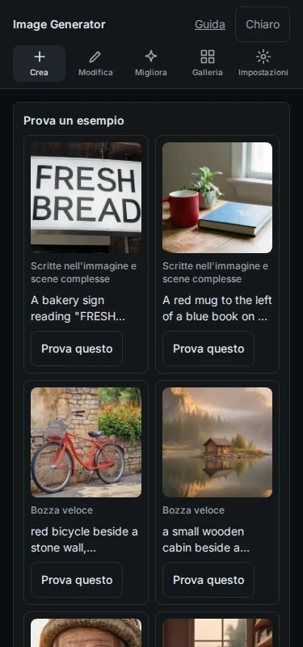
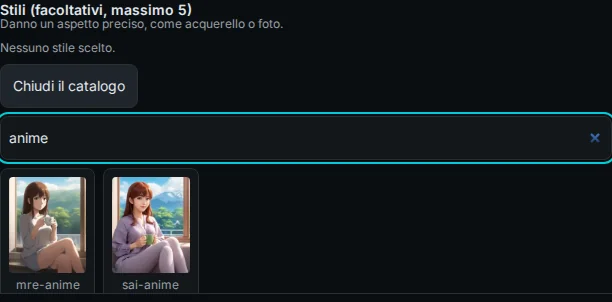
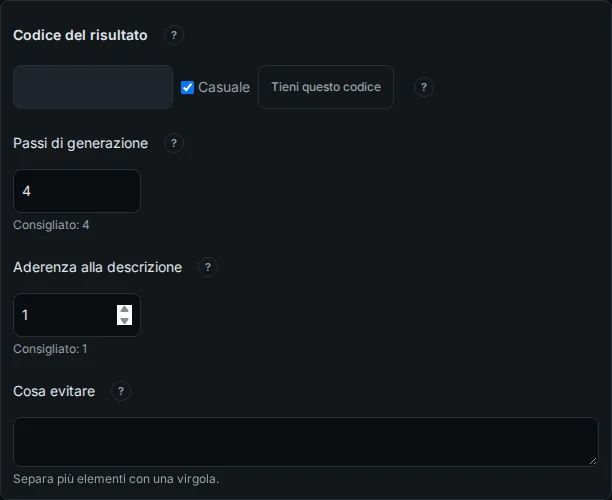
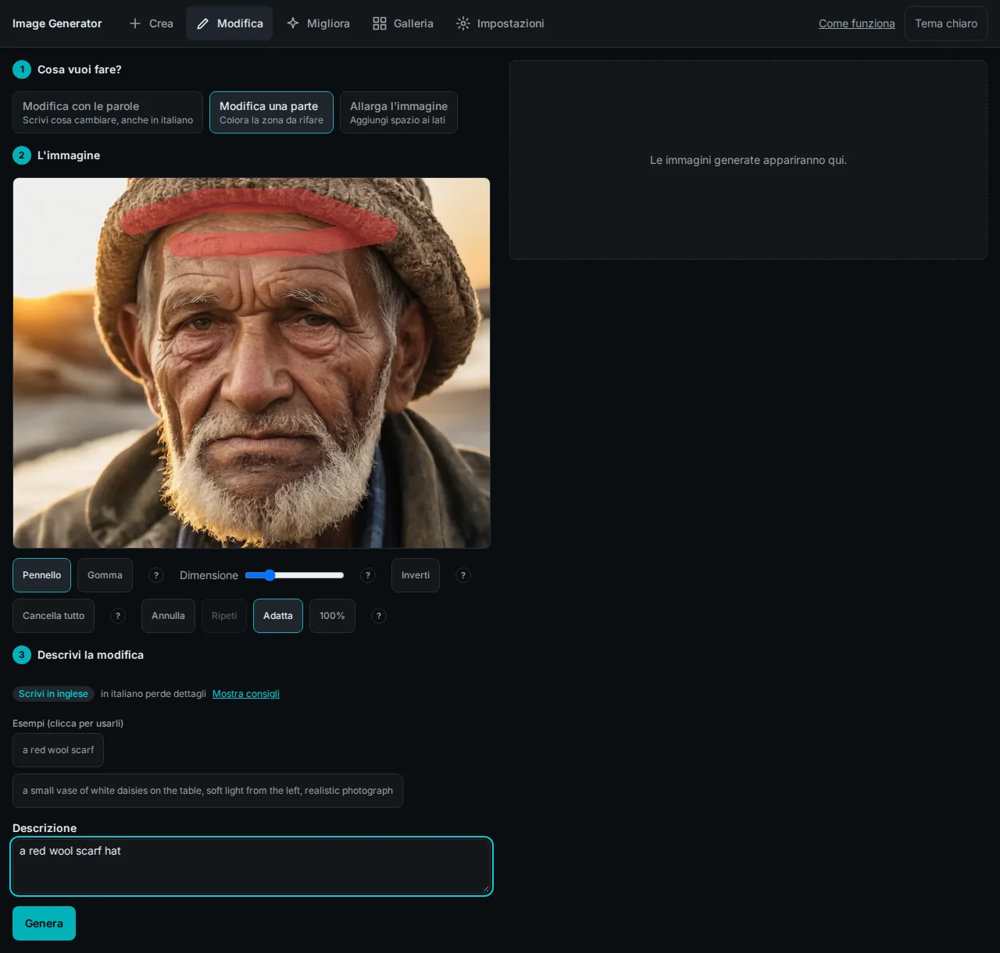
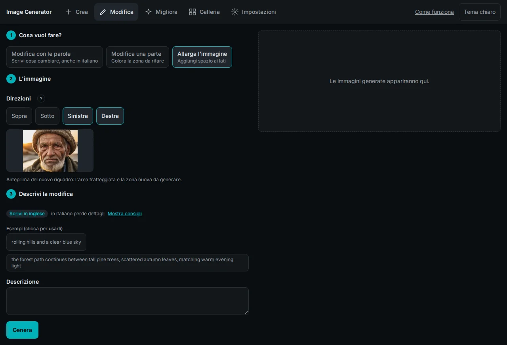
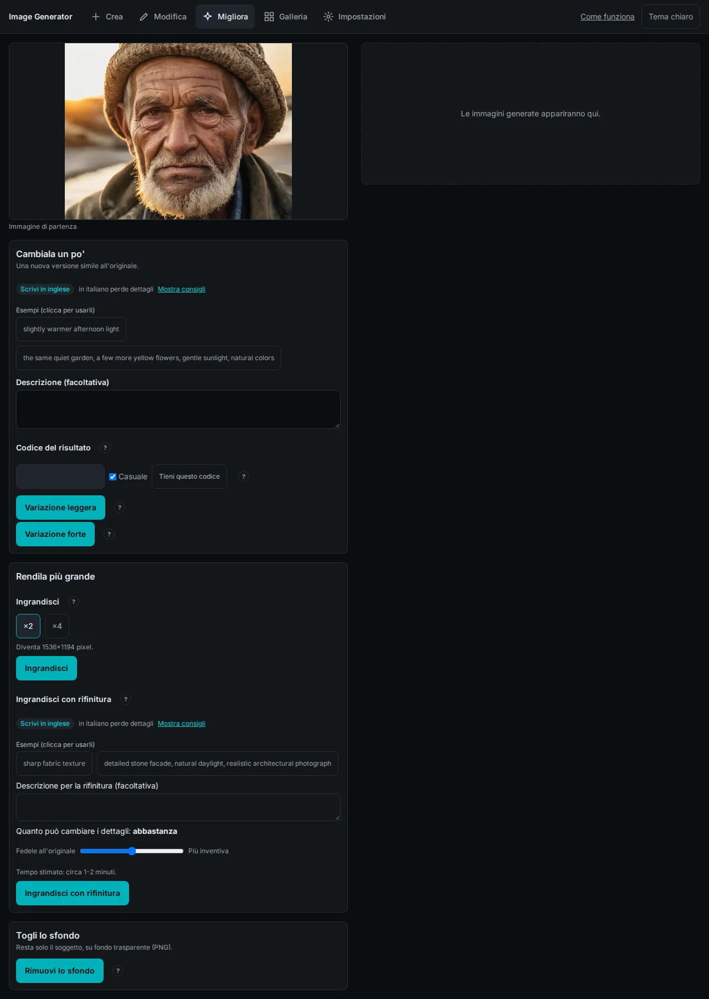
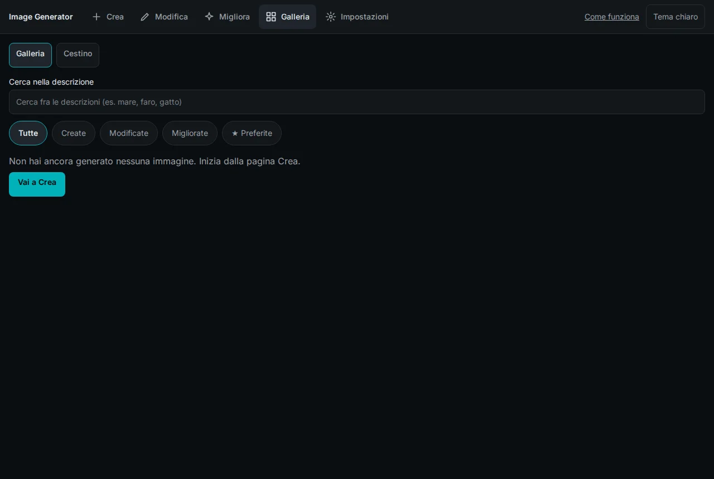
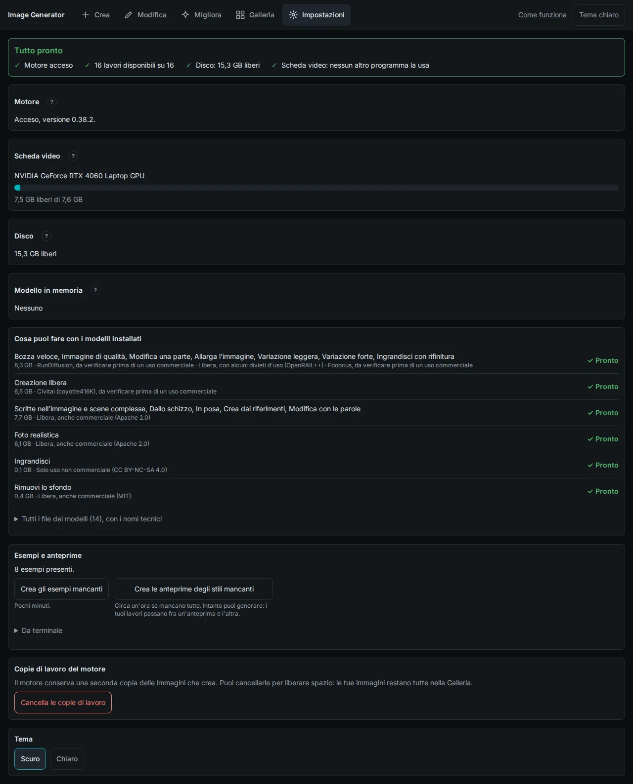

**English** | [Italiano](./user-guide.it.md)

# User Guide

This guide walks through Image Generator from startup to every feature. It assumes the app is already installed: if not, follow [Installation](../README.md#installation) in the README first.

The interface is in Italian. Every button and label is quoted here exactly as it appears on screen, followed by its meaning in English.

## Contents

- [Starting and stopping](#starting-and-stopping)
- [The interface at a glance](#the-interface-at-a-glance)
- [Crea: create an image](#crea-create-an-image)
- [Modifica: edit an image](#modifica-edit-an-image)
- [Migliora: improve an image](#migliora-improve-an-image)
- [Galleria: gallery and trash](#galleria-gallery-and-trash)
- [Impostazioni: settings](#impostazioni-settings)
- [Keyboard](#keyboard)
- [Limits](#limits)
- [Where your images are stored](#where-your-images-are-stored)
- [Troubleshooting](#troubleshooting)

## Starting and stopping

**From the applications menu (Linux).** Run `./scripts/install_launcher.sh` once from the project folder. Two entries appear in the menu:

- **Image Generator** starts the engine and the app and opens them in a dedicated window (Chrome or Chromium in app mode; otherwise the default browser).
- **Chiudi Image Generator** stops both and frees the GPU memory.

**From a terminal.** Run `./scripts/start.sh` in the project folder. When `Pronto: apri http://127.0.0.1:8000` appears, open that address in the browser. Ctrl+C stops the app and the engine; from another terminal, `./scripts/stop.sh` stops only what `start.sh` launched.

The app is reachable only from this computer, at `127.0.0.1`. Other devices on the network cannot open it.

## The interface at a glance

The top bar holds the five pages: **Crea** (create), **Modifica** (edit), **Migliora** (improve), **Galleria** (gallery) and **Impostazioni** (settings). On the right:

- **Come funziona** (on small screens **Guida**) opens the in-app guide: which job to pick, why some jobs want English, how to continue from an image, how to repeat a result, what to do when something fails.
- **Tema chiaro** / **Tema scuro** switches between light and dark theme. The default is dark; the choice is remembered by the browser.

Always visible when relevant:

- **Active jobs indicator**: "<job> in corso · NN%" or "N lavori in corso" (N jobs running). It stays visible on every page, so you can leave the page that started a job.
- **Engine banner**: a red banner, "Il motore che crea le immagini si è fermato." (the engine has stopped), with the commands to restart it. It disappears by itself when the engine is back.
- **GPU warning**: above "Genera", "Un altro programma sta usando la scheda video." (another program is using the GPU) with the list of processes and their memory. It does not block you, but close those programs before generating: see [Troubleshooting](#troubleshooting).
- **"?" buttons** next to many controls show a short explanation on hover, focus or click.

The layout adapts to narrow screens:

## Crea: create an image

### 1. Pick a job

Under **Cosa vuoi creare?** (what do you want to create?) the jobs are split into two groups.

**Da una descrizione** (from a description):

| Job | Use it for | Write in |
|---|---|---|
| Bozza veloce | Trying an idea quickly before refining it (about 4 s) | English |
| Immagine di qualità | A polished image, with styles (about 30 s) | English |
| Creazione libera | Any subject: the description runs as written, with no added filters (about 30 s) | English |
| Scritte nell'immagine e scene complesse | Readable lettering and scenes with several objects (about 9 s) | Italian or English |
| Foto realistica | Natural, believable photos, people included (about 17 s) | Italian or English |

**Partendo da tue immagini** (starting from your images):

| Job | Images to add | Write in |
|---|---|---|
| Dallo schizzo | A sketch ("Schizzo"), plus an optional second image for style or subject ("Stile o soggetto") | Italian or English |
| In posa | Two images: the pose ("Posa") and the character ("Personaggio"). The pose of the first is applied to the character of the second | Italian or English |
| Crea dai riferimenti | 1 to 3 photos of the same subject or character, to place it in a new scene | Italian or English |

Each card shows the expected time, the language, and **pronto subito** (ready now) when its model is already loaded in memory, so the first image will not wait for a model switch.

**Missing models.** If a card says "Mancano dei modelli: clicca per scaricarli." (models missing: click to download), clicking it opens a window listing the files, their size, the total and the disk space that will remain. **Scarica** (download) starts it; it is hidden when there is not enough space. During the download you see "Modello N di M" with a progress bar and **Annulla** (cancel); on error, **Riprova** (retry). When it finishes, the job is selected for you.

### 2. Describe the image

Write in **Descrivi l'immagine che vuoi** (describe the image you want), up to 2000 characters.

- Above the box a badge says which language to use. **Mostra consigli** (show tips) opens advice for that job.
- For SDXL jobs ("Scrivi in inglese", write in English), the app checks the text as you type. If it looks Italian, it says so and offers **Passa a <job>, che capisce l'italiano** (switch to a job that understands Italian).
- **Esempi (clicca per usarli)** (examples, click to use them) fills the box with a sample description.

The form is kept while you move between pages, in the current browser tab only. When it is restored you see "Ripresa da dove avevi lasciato." (picked up where you left off) and a **Svuota la descrizione** (clear the description) button. Reference images are not kept.

### 3. Shape, number, styles

- **Proporzioni** (aspect ratio): six common shapes are shown with their typical use (stories and phone, social post, profile, classic photo, photography, screen and video). Hover to see the pixels. **Altri formati** (more formats) shows all the others.
- **Numero di immagini** (number of images): 1 to 4 per run. More images give more choice and take longer.
- **Stili (facoltativi, massimo 5)** (styles, optional, up to 5), only for SDXL jobs. **Sfoglia tutti gli stili** (browse all styles) opens the catalog of 277 styles with a preview each. Type in the search box ("Cerca fra tutti gli stili", for example watercolor, anime, photo) to narrow it down; a search shows up to 24 results. Click a style to add it; click the "×" on its chip to remove it. Previews appear once they have been generated from [Impostazioni](#examples-and-previews); until then each style shows its initial.

### 4. Reference images and sketches

For jobs that start from your images, **Immagini di riferimento** (reference images) shows which images are needed and a counter ("N di M").

- **Aggiungi da file** (add from file) uploads a PNG, JPEG or WebP.
- **Aggiungi dalla galleria** (add from gallery) opens "Scegli un'immagine dalla galleria" with your 24 most recent images.
- The "×" on a thumbnail removes it.

For **Dallo schizzo** you can also draw: **Disegna lo schizzo** opens a white 1024×1024 canvas with **Pennello** (brush), **Gomma** (eraser), three thicknesses (**Fine**, **Medio**, **Spesso**), **Annulla** (undo), **Cancella tutto** (clear all) and **Usa come schizzo** (use as sketch).

### 5. Advanced options

**Opzioni avanzate** is closed by default.

- **Codice del risultato** (result code, the seed). With **Casuale** (random) checked, every run uses a new code. **Tieni questo codice** (keep this code) fixes it: the same description, job and code give the same image again. When the panel is closed, a kept code is still shown next to it.
- **Passi di generazione** (generation steps), with the recommended value for the job.
- **Aderenza alla descrizione** (how closely to follow the description), with the recommended value.
- **Cosa evitare** (what to avoid, the negative prompt), only for jobs that support it. Separate items with commas.

### 6. Generate and follow progress

**Genera** (generate) sits in a bar at the bottom of the page, with a summary of job, number of images and time per image. If something is missing, a line under it says what.

While the job runs the result area shows:

- "In coda..." / "In coda, posizione N." (queued, position N)
- "Preparo il modello, circa N secondi." (loading the model), which happens only when you switch to a different kind of job
- a progress bar and a live preview ("Anteprima in corso")
- "Ci sta mettendo più del previsto." (taking longer than expected) after 60 seconds
- **Annulla** to stop the job; on error, the message and **Riprova** (retry)

Only one job runs at a time; others wait in the queue. You can change page while waiting: the indicator in the top bar follows the job.

### 7. What to do with a result

Under each image:

- **Aggiungi ai preferiti** (add to favourites)
- **Scarica** (download): the PNG includes its settings, see [Reuse settings](#reuse-settings-from-an-image)
- **Un'altra variante** (another variant): the same settings with a new code. The variant is saved to the gallery and does not appear on this page: "Nuova variante avviata: la trovi in Galleria quando è pronta."
- **Modifica**: opens the image on the Modifica page, in "Modifica con le parole" mode
- **Migliora**: opens the image on the Migliora page

Before you generate on this page, the result area shows your last four images under **Le tue ultime immagini** and a link to the gallery.

### First-run examples

While the gallery is completely empty (trash included), the right side of the page shows **Prova un esempio** (try an example): ready-made images with their job and description. **Prova questo** (try this) fills job, description, code and aspect ratio and moves the focus to **Genera**; it does not start anything. If the example images have not been generated yet, only the descriptions are shown.

### Reuse settings from an image

**Riprendi le impostazioni da un'immagine creata qui** (reuse the settings of an image created here) accepts a file chosen from disk, or an image dropped onto the description box. For a PNG created by this app it restores job, description, code (kept), aspect ratio, styles, steps, adherence and negative prompt, without starting the generation. Reference images are never restored: add them again. Images without embedded settings show "Questa immagine non contiene impostazioni di Image Generator."

## Modifica: edit an image

The page has three numbered steps and the result area on the right.

**Step 1, Cosa vuoi fare?** (what do you want to do?):

- **Modifica con le parole** (edit with words): describe the change, Italian works
- **Modifica una parte** (edit one part): paint the area to redo
- **Allarga l'immagine** (extend the image): add space on the sides

**Step 2, L'immagine** (the image): drag an image onto the area, or use **Scegli un file** (choose a file) or **Scegli dalla Galleria** (choose from the gallery). Accepted: PNG, JPEG or WebP, up to 20 MB and 4096 px per side. The **Modifica** buttons in the gallery and under results open this page with the image already loaded.

### Painting the area to change

In **Modifica una parte**, paint over the area to regenerate; it is shown in red.

- **Pennello** (brush) and **Gomma** (eraser), with **Dimensione** (size) from 8 to 160 px
- **Inverti** (invert): swaps painted and unpainted areas
- **Cancella tutto** (clear all), **Annulla** (undo), **Ripeti** (redo), up to 20 steps
- **Adatta** (fit) and **100%** for zoom

Mouse, touch and pen all work.

### Extending the image

In **Allarga l'immagine**, under **Direzioni** pick one or more of **Sopra** (top), **Sotto** (bottom), **Sinistra** (left), **Destra** (right). Each adds 30% on that side. The preview shows the new frame; the dashed area is what will be generated.

**Step 3, Descrivi la modifica** (describe the change): required for "Modifica con le parole" and "Modifica una parte", optional for "Allarga l'immagine". Only "Modifica con le parole" offers the result code and advanced options (steps and adherence).

**Genera** stays disabled until the step is complete, and the line under it says why: "Manca l'immagine: aggiungila al passo 2." (image missing), "Disegna la zona da modificare prima di generare." (paint the area first), "Scegli almeno una direzione prima di generare." (pick at least one direction). If the job's models are missing, **Scarica i modelli mancanti** opens the download window. Edits produce one image at a time.

## Migliora: improve an image

Load the starting image with **Scegli un file** or by dragging it in, or with **Migliora** from the gallery or from a result. It appears as **Immagine di partenza** (starting image). Three tabs:

**Cambiala un po'** (change it a little), a new version close to the original:

- optional **Descrizione** and **Codice del risultato**
- **Variazione leggera** (subtle variation) keeps the composition
- **Variazione forte** (strong variation) reinterprets the image more freely

**Rendila più grande** (make it bigger):

- **Ingrandisci** (upscale) with **×2** or **×4**; the target size is shown ("Diventa L×A pixel"). ×4 is refused when a side would exceed 8192 px.
- **Ingrandisci con rifinitura** (upscale with refinement), always ×2: an optional description and a slider from **Fedele all'originale** (faithful) to **Più inventiva** (more inventive) that sets how much the details may change. It takes about 1-2 minutes.

**Togli lo sfondo** (remove the background): **Rimuovi lo sfondo** keeps only the subject, on a transparent PNG.

Results show a **Confronto prima/dopo** (before/after) slider, with a checkerboard behind transparent images, and the same actions as on the Crea page.

This page has no shortcut to download missing models: install them from [Impostazioni](#models).

## Galleria: gallery and trash

Every generated image is saved in the gallery.

- **Cerca nella descrizione** (search the description): matches any part of the text you wrote
- Filters: **Tutte** (all), **Create**, **Modificate** (edited), **Migliorate** (improved), **★ Preferite** (favourites)
- 24 images per page; more load as you scroll
- On each card, on hover (always visible on touch screens): favourite, **Scarica** (download), **Modifica** (edit)

An empty gallery shows "Non hai ancora generato nessuna immagine." with **Vai a Crea** (go to Crea):

### Image detail

Clicking a card opens **Dettaglio immagine**: the image, its description, job, size and age.

- **Dettagli tecnici** (technical details): full description, result code, model, duration
- **Vedi immagine di origine** (see source image), when the image was made from another one
- **Continua da qui** (continue from here): **Modifica**, **Migliora**, **Un'altra variante**. A variant started here is announced at the bottom of the page and saved in the gallery when ready.
- **Scarica**, and add or remove from favourites
- **Elimina** (delete) asks "Eliminare questa immagine?"; **Sì, elimina** moves it to the trash

Close with **✕**, Esc or a click outside.

### Trash

The **Cestino** tab lists deleted images with their total size. **Ripristina** (restore) puts an image back. **Svuota il cestino** (empty the trash) asks for confirmation, deletes the images for good and reports the space freed. The trash is never emptied automatically.

## Impostazioni: settings

The page refreshes every 10 seconds.

- **Summary**: "Tutto pronto" (all set) or "Da sistemare" (needs attention), with engine, available jobs, free disk and GPU use.
- **Motore** (engine): "Acceso, versione …" (running, version) or "Non risponde." (not responding).
- **Scheda video** (GPU): name and memory in use, plus the warning when another program uses it.
- **Disco** (disk): free space, with the recommended minimum of 5 GB, and the size of the trash with a link to it.
- **Modello in memoria** (model in memory): the model family currently loaded, or "Nessuno" (none).

### Models

**Cosa puoi fare con i modelli installati** (what you can do with the installed models) lists, per model family, the jobs it enables, its size, its license in plain words, and **✓ Pronto** (ready) or **! Manca un modello** (a model is missing).

**Tutti i file dei modelli** opens the full table (model, status, size, license). For a missing model, **Installa · X GB** asks for confirmation, then shows a progress bar with **Annulla**, then "Verifica in corso..." (verifying the file) and **Installato**. Only one download runs at a time in the whole app, and a download is refused if it would leave less than the minimum free space. **Da terminale** shows the equivalent command with a **Copia** (copy) button.

### Examples and previews

**Esempi e anteprime** generates, on your GPU, the images used by the first-run examples and by the style catalog:

- **Crea gli esempi mancanti** (create the missing examples): a few minutes
- **Crea le anteprime degli stili mancanti** (create the missing style previews): about an hour if none exist. You can keep generating meanwhile: your jobs run between one preview and the next.

Progress is shown with **Annulla**; cancelling keeps the images already made.

### Engine working copies

The engine keeps a second copy of every image it creates. **Cancella le copie di lavoro** (delete the working copies) frees that space after a confirmation; your images stay in the gallery.

### Theme

**Scuro** (dark) or **Chiaro** (light).

## Keyboard

- Tabs (edit modes, Gallery/Trash): left and right arrows, Home, End
- Dialogs: Esc closes them (except the model download while in progress); Tab stays inside the dialog
- "?" tips: Esc closes them
- Sliders (brush size, before/after, refinement): arrow keys

Enter does not start a generation, and pasting an image from the clipboard is not supported.

## Limits

| What | Limit |
|---|---|
| Uploaded image | PNG, JPEG or WebP, up to 20 MB and 4096 px per side. Transparent uploads are flattened on white |
| Uploaded files | Removed after 7 days (generated images are not) |
| Description and "Cosa evitare" | 2000 characters each |
| Images per run | 1 to 4 (edits: 1) |
| Styles per image | 5 |
| Result code | 0 to 4294967295 |
| Upscale | 8192 px per side |
| Job duration | 600 seconds, then the job fails with a timeout message |
| Job requests | 600 per minute for the whole app |

## Where your images are stored

Everything stays in the `data/` folder of the project (configurable with `DATA_DIR`):

- `data/studio.db`: the gallery database
- `data/images/YYYY/MM/`: the full-size PNGs
- `data/thumbs/`: gallery thumbnails
- `data/uploads/`, `data/examples/`, `data/style_previews/`, `data/styles/`

Each PNG carries its settings (description, job, models, code, size, steps, styles and more) in a text chunk named `studio_immagini`. Anyone who receives the file can read them: strip the metadata before sharing if the description is private.

## Troubleshooting

| What you see | What to do |
|---|---|
| Red banner "Il motore che crea le immagini si è fermato." | Close and reopen the app from the menu, or run `./scripts/stop.sh` and `./scripts/start.sh`. The engine log is in `engine/comfy.log`. |
| "Memoria della GPU esaurita" (GPU out of memory) | Use a smaller format, or one image at a time. |
| "Un altro programma sta usando la scheda video." | Close the programs listed. For Ollama: `ollama ps` shows the loaded model, `ollama stop <name>` unloads it. Generating while another program held the GPU has already caused the GPU to drop off the system once, which needed a reboot. |
| "Spazio su disco esaurito" (disk full) | Free space, use **Cancella le copie di lavoro** in Impostazioni, or empty the trash. |
| A job card is disabled or says models are missing | Click it to download the models, or install them from Impostazioni. |
| `nvidia-smi` says "No devices were found" | Restart the computer. |
| "Troppe richieste" (too many requests) | Wait a minute and try again. |

---

[Back to README](../README.md)
